<a id="top"></a>

<div align="center">


# RentNest

**A US home marketplace to rent or buy, with verified landlords, Stripe payments, offers and admin-reviewed listings.**


[](LICENSE)

[**Live site**](https://YOUR-FRONTEND-URL.vercel.app) · [**Backend API**](https://rentnest-backend-one.vercel.app/api) · [**API docs**](https://github.com/Zarif207/rentnest-backend/blob/main/docs/api.md) · [**API integration**](API_INTEGRATION.md)

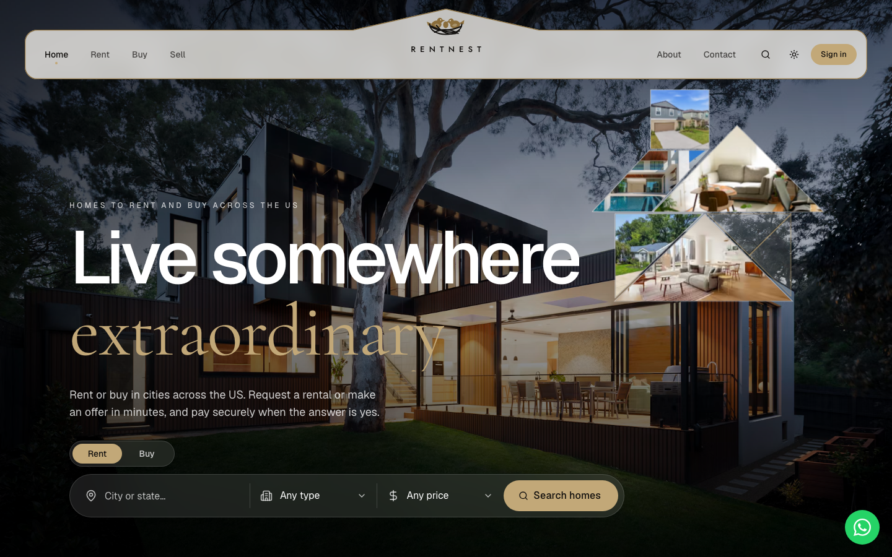

</div>

---

## Contents

1. [Overview](#overview)
2. [Screenshots](#screenshots)
3. [Features](#features)
4. [How it works](#how-it-works)
5. [Tech stack](#tech-stack)
6. [Engineering highlights](#engineering-highlights)
7. [Performance and quality](#performance-and-quality)
8. [Design system](#design-system)
9. [Project structure](#project-structure)
10. [Getting started](#getting-started)
11. [Demo access](#demo-access)
12. [API integration](#api-integration)
13. [Deployment](#deployment)
14. [Decisions, trade-offs and limitations](#decisions-trade-offs-and-limitations)
15. [Roadmap](#roadmap)
16. [Author](#author)
17. [License](#license)

---

## Overview

Renting and buying a home usually means juggling listing sites, phone calls and bank transfers, with no way to tell a real landlord from a fake one. RentNest puts the whole journey in one place:

- **Renters and buyers** search homes on a map and request a rental or make an offer.
- **Landlords** list homes, but only after an admin has approved them, and every listing is reviewed before it goes public.
- **Payments** (rent and the buyer's deposit) go through Stripe Checkout.

The project is the frontend: a Next.js App Router app that consumes a separate Express + Prisma API.

**At a glance**

- **Three roles plus a read-only observer:** tenant (renter and buyer), landlord (lister and seller) and admin each have their own dashboard; the observer can view the admin and landlord dashboards but can't change anything.
- **Rent and buy:** rentals (request → approve → pay → complete) and sales (offer → counter → accept → deposit → sold).
- **Stripe Checkout** for rent payments and earnest-money deposits, confirmed by the backend.
- **Leaflet map** with marker clusters, plus a page per US state for each listing type.
- **Trust workflow:** admins approve landlords, and review every listing (Pending → Live / Rejected with a note).
- **Notifications:** an in-app bell and red badges on the matching dashboard section.

<p align="right"><a href="#top">Back to top</a></p>

---

## Screenshots

| | | |
| :---: | :---: | :---: |
| <br/>Home (light) | 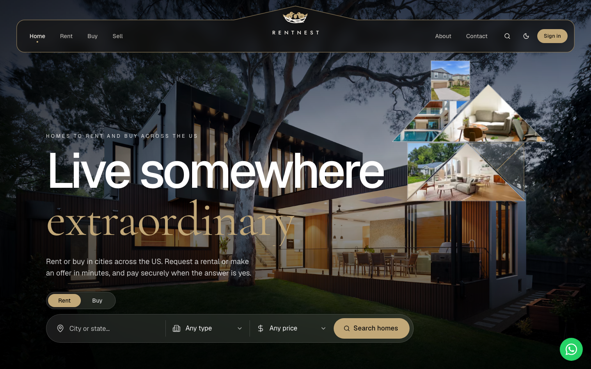<br/>Home (dark) | 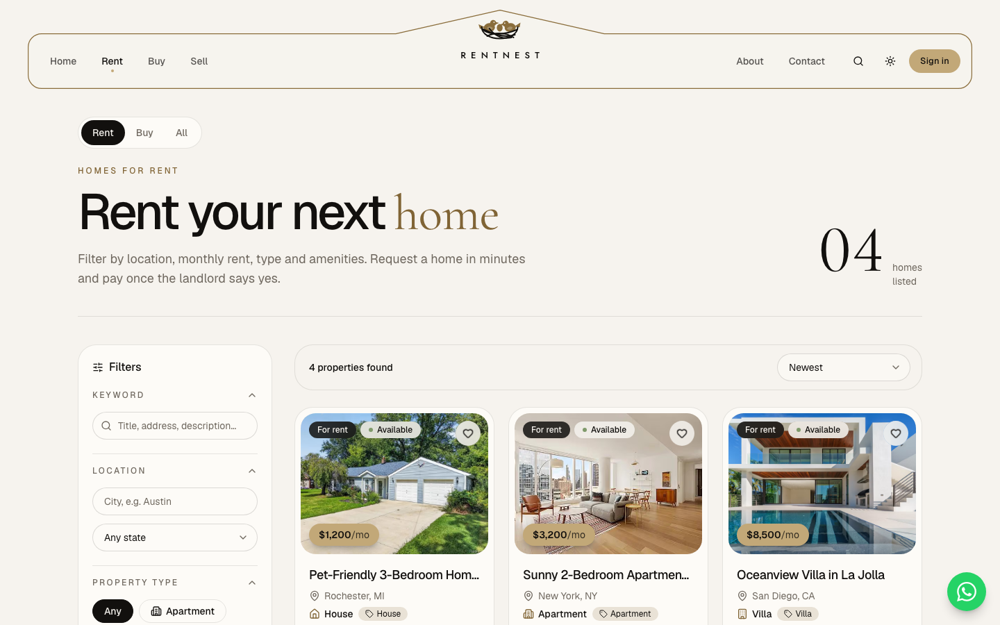<br/>Rent with filters |
| 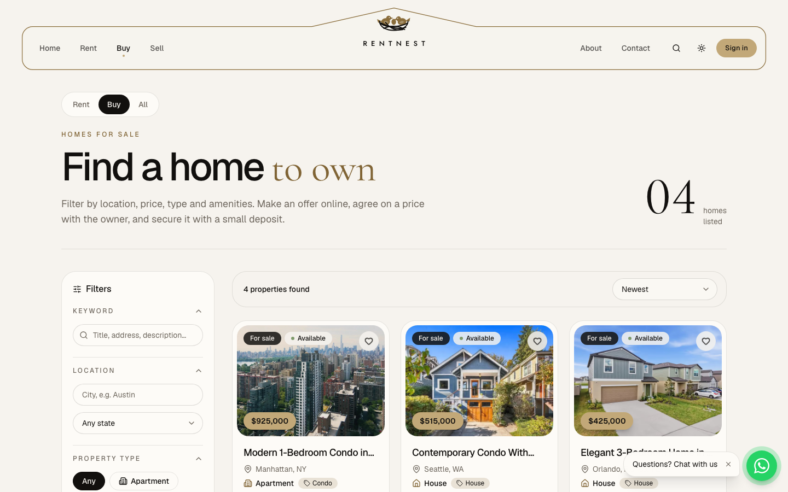<br/>Buy | 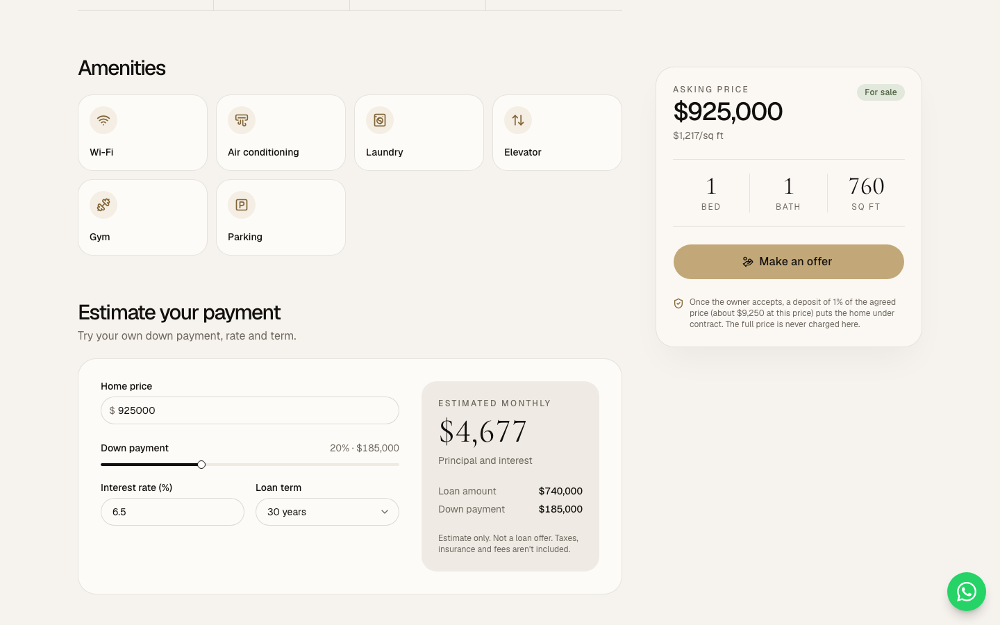<br/>Home for sale + payment estimate | 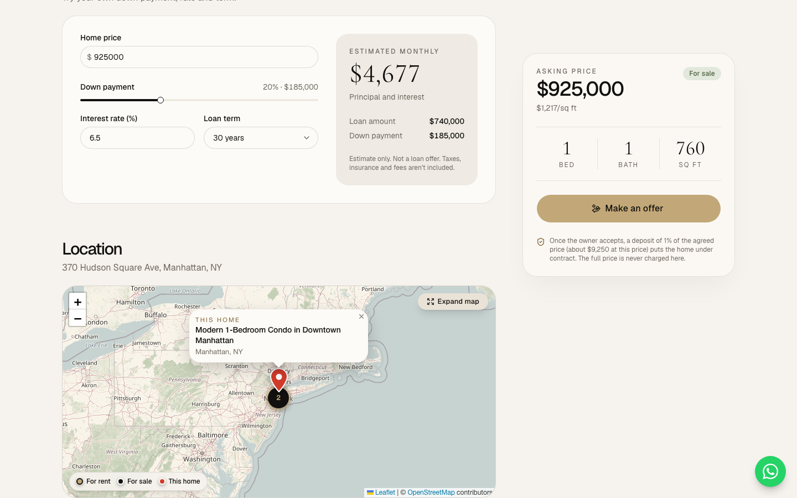<br/>Map |
| 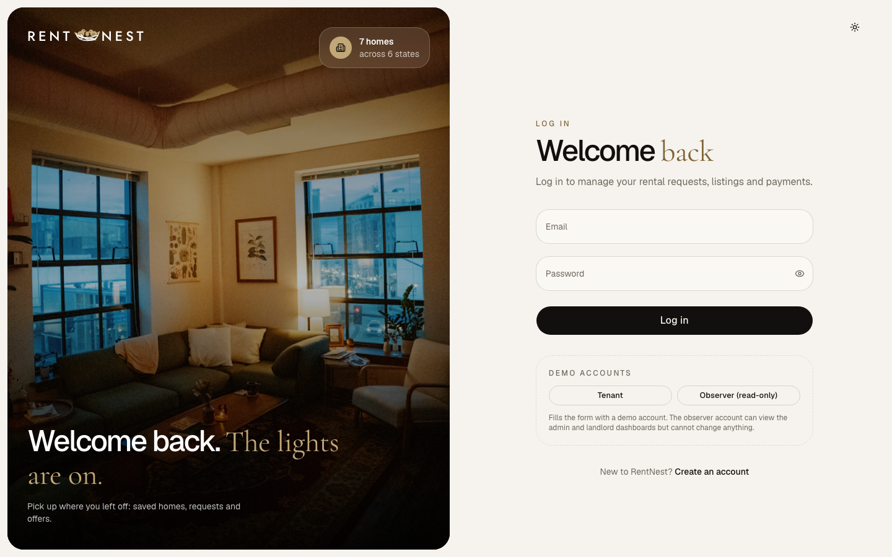<br/>Login | 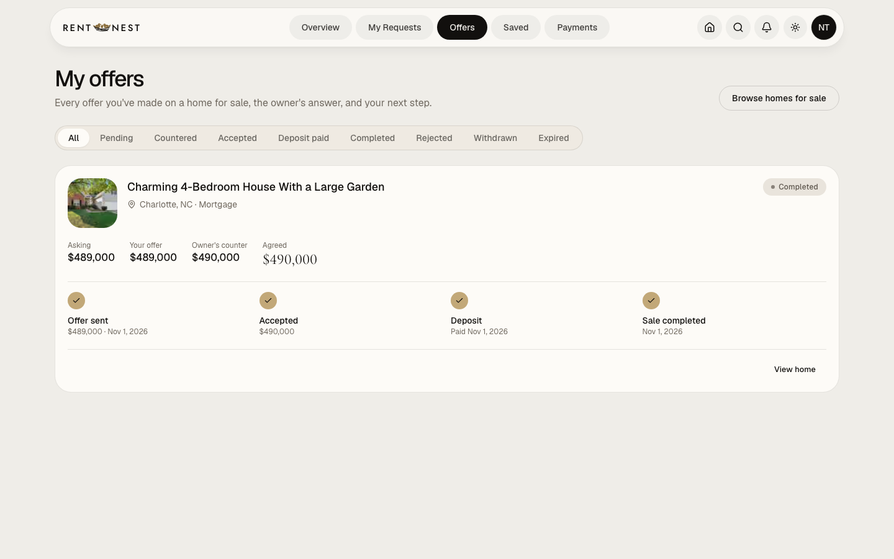<br/>Tenant offers | 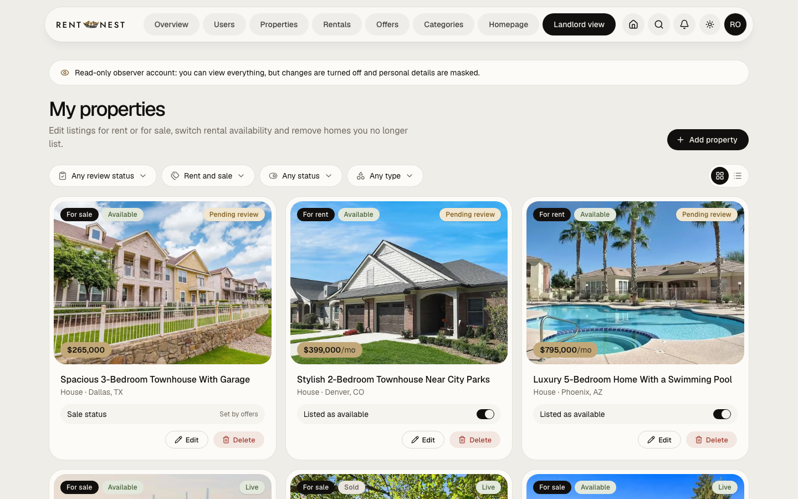<br/>Landlord listings + review chips |
| 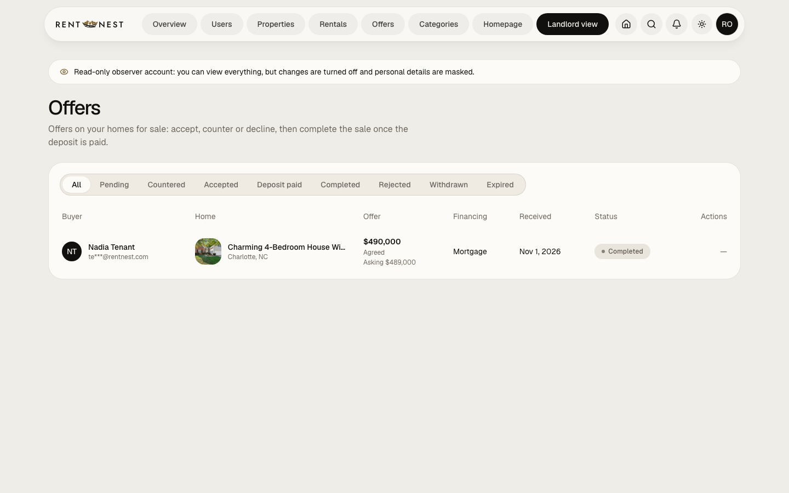<br/>Landlord offers | 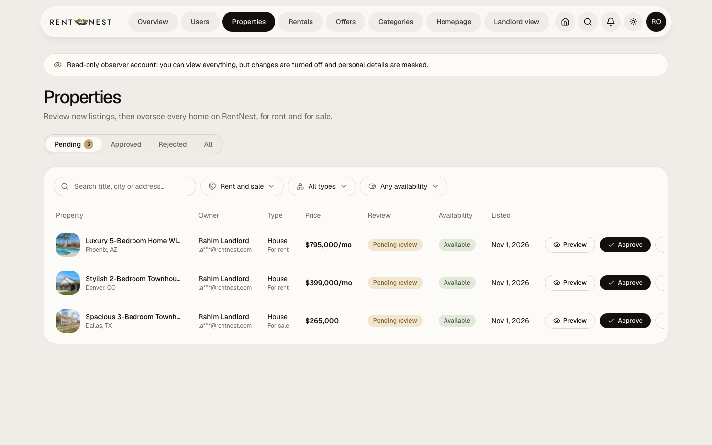<br/>Admin review (Pending) | 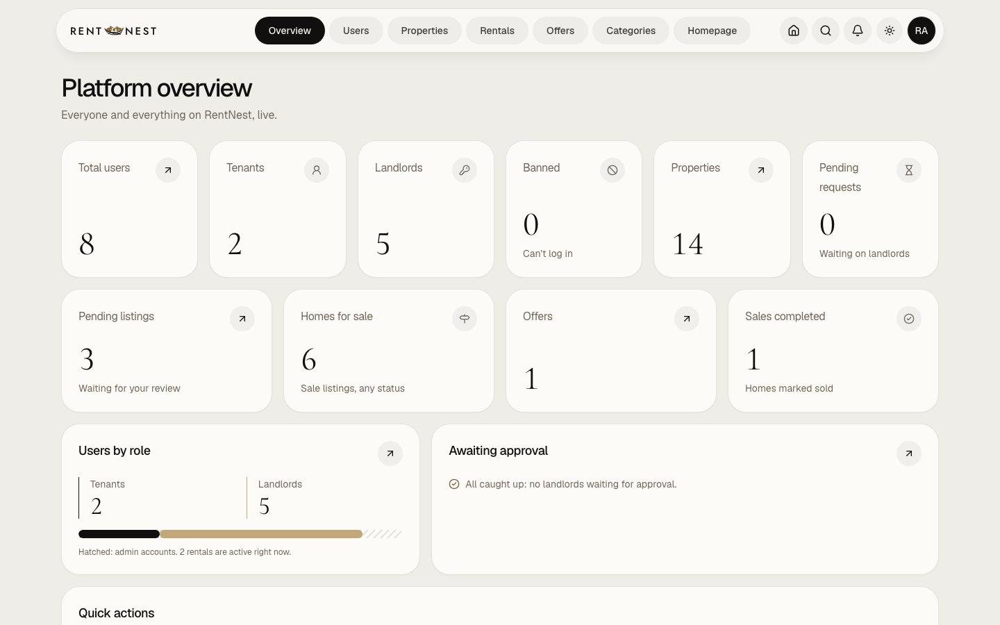<br/>Admin overview |
| 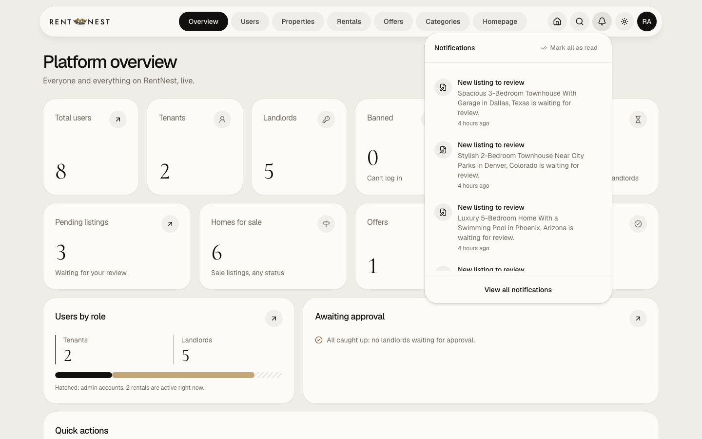<br/>Notifications | 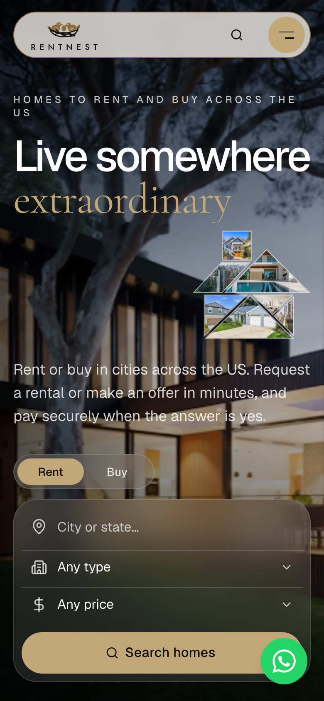<br/>Mobile home | 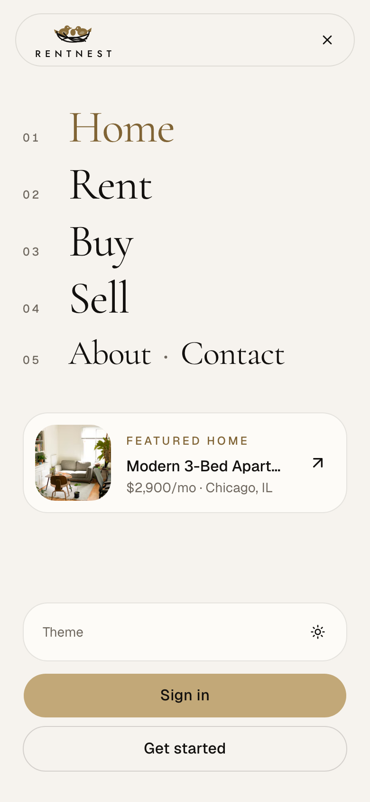<br/>Mobile menu |

A full-page capture of the home page is in [`docs/screenshots/home-full.png`](docs/screenshots/home-full.png). To regenerate every image, run `node scripts/screenshots.mjs <baseUrl>` against a running build.

<p align="right"><a href="#top">Back to top</a></p>

---

## Features

### Tenant (renter and buyer)

| Area | What they can do |
| --- | --- |
| Rent | Request a home with a move-in date and lease length; track Pending → Approved → Active → Completed; pay with Stripe once approved |
| Buy | Make an offer (amount, financing, message); withdraw it or accept a counter-offer; pay the earnest-money deposit with Stripe |
| Saved homes | Heart any listing; a Saved page in the dashboard |
| Reviews | Rate and review a home after an active or completed rental |
| History | Payments and deposits, with receipt details |
| Notifications | Bell with an unread count and a full page; red badges on the matching section, cleared when it's opened |

### Landlord (lister and seller)

| Area | What they can do |
| --- | --- |
| Approval | New landlord accounts start **Pending**. They can look around but can't list homes or answer requests until an admin approves them |
| Listings | Create, edit and delete listings for rent or sale: photos (ImgBB), a map pin, a property type (the building) and a category (the market segment) |
| Review status | Each listing shows **Pending review**, **Live** or **Rejected** (with the admin's note and an "Edit and resubmit" action); a private preview for listings that aren't live yet |
| Requests | Approve or reject rental requests; mark a rental completed |
| Offers | Accept, reject or counter; complete the sale after the deposit |
| Reviews | Read what tenants wrote, filtered by property |

### Admin

| Area | What they can do |
| --- | --- |
| Overview | Live counts from the API: users, pending landlords, pending listings, rentals and offers |
| Users | Search and filter; block or unblock; approve or reject landlords |
| Listing review | Tabs **Pending** (default, oldest first, with a count), Approved, Rejected, All; Approve, or Reject with a 3–500 character reason; preview before deciding |
| Records | All rentals and all offers, with filters |
| Catalog | Categories: create, rename, delete |
| Homepage | Choose the hero homes, featured homes, state tiles, type images, the number of latest listings and the section order; a picked home that isn't public (pending, rejected, rented or sold) is flagged as hidden |

### Observer (read-only)

| Area | What they can do |
| --- | --- |
| Viewing | Open the admin dashboard and a "Landlord view" of every landlord's listings, requests, offers and reviews |
| Changes | None: every write is refused by the API ("Observer accounts are read-only"), and the dashboard shows a read-only notice |
| Privacy | Other people's emails, phone numbers and Stripe IDs arrive masked |

### Public and SEO

| Area | What it does |
| --- | --- |
| Browse | `/rent`, `/buy` and `/properties`; filters in the URL (keyword, state, city, type, category, price, amenities, available only); map view |
| State pages | `/rent/[state]` and `/buy/[state]` for every US state that has listings |
| A home's page | Gallery, details, amenities, location map, reviews, landlord card, payment estimate (sale), "More homes in {State}" |
| Visibility | Only approved listings are public; rented and sold homes leave the lists but keep their page, which shows a banner and a disabled action |
| SEO | Per-page metadata, `sitemap.ts`, `robots.ts`, `manifest.ts`, dynamic Open Graph images, JSON-LD (`lib/structured-data.ts`); dashboards, auth pages and thin filter combinations are `noindex` |
| Extras | WhatsApp chat button, cookie consent banner, light and dark themes |

<p align="right"><a href="#top">Back to top</a></p>

---

## How it works

### System architecture

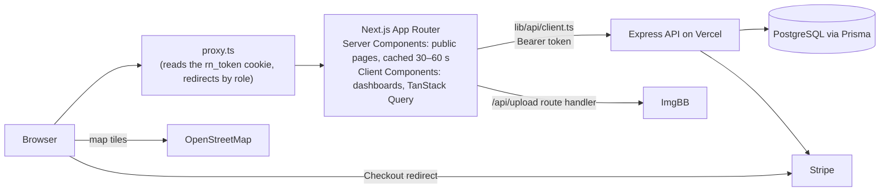

### Rental lifecycle

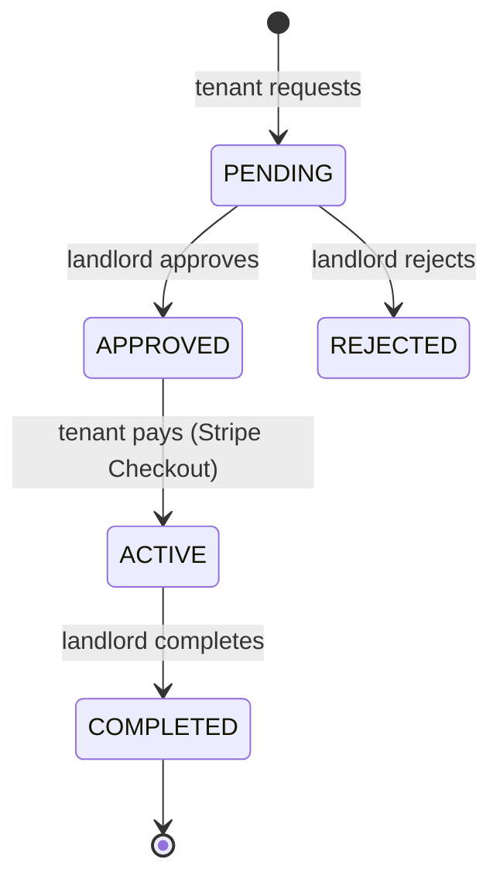

### Offer lifecycle

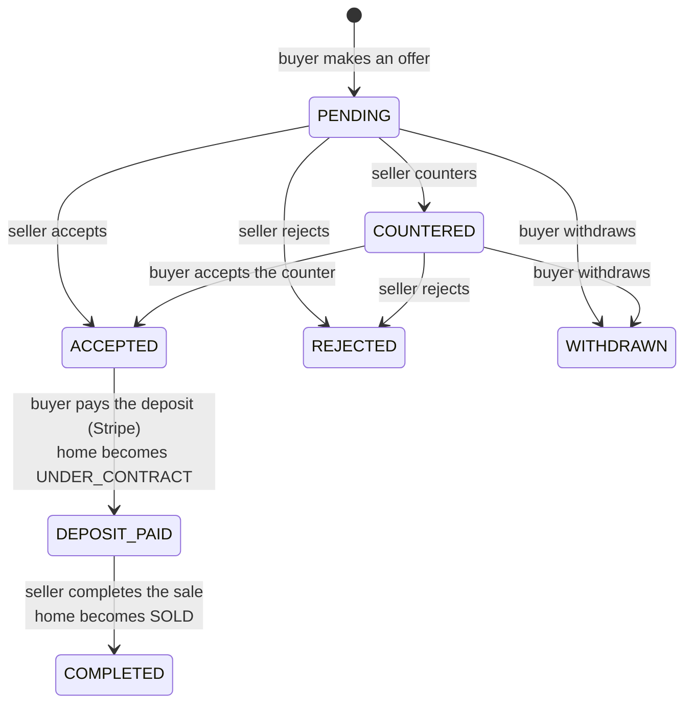

### Listing review

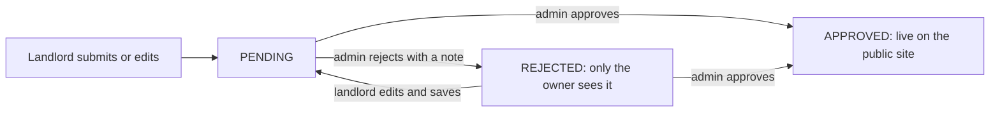

Each decision sends the landlord a notification, and each new submission notifies the admins. If two admins decide at the same moment, the second gets a 409.

### Auth and route protection

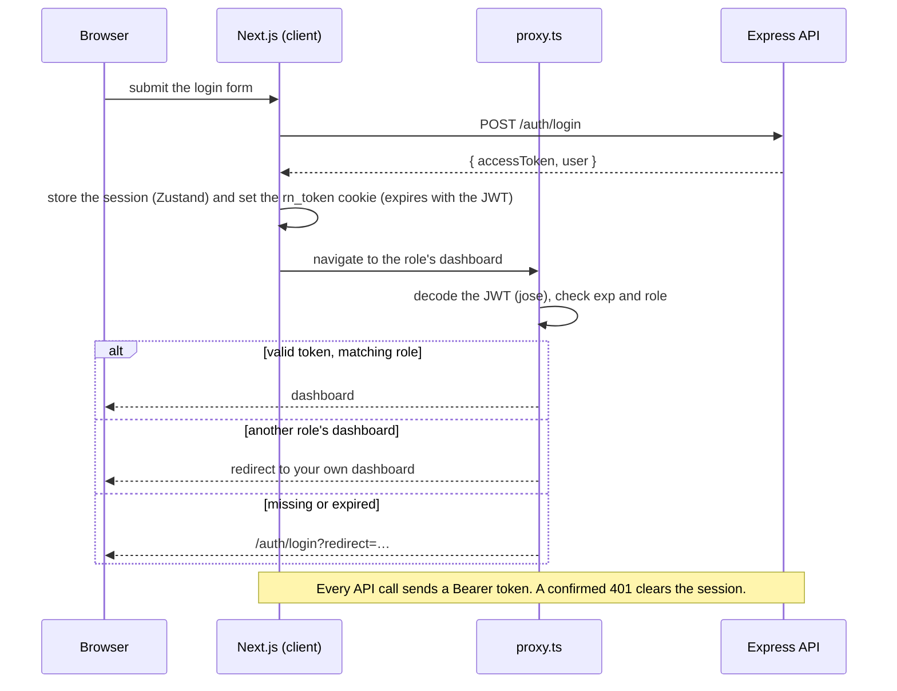

<p align="right"><a href="#top">Back to top</a></p>

---

## Tech stack

| Layer | Choice | Why |
| --- | --- | --- |
| Framework | Next.js 16 App Router, React 19, Cache Components | Static or cached public pages for SEO and speed; client islands only where they're needed |
| Language | TypeScript (strict) | Types written from the backend's responses; no `any` |
| Styling | Tailwind CSS v4, shadcn/ui on Radix | Design tokens in CSS variables; accessible primitives |
| Server state | TanStack Query v5 | Caching, background refetch, optimistic updates with rollback |
| Client state | Zustand | A small auth store that's easy to read outside React (the API client) |
| Forms | React Hook Form + Zod | Schema validation, and server `errorDetails` mapped onto fields |
| Motion | Lenis, GSAP + ScrollTrigger, `motion`, CSS 3D | Scroll scenes on the public site; lightweight transitions elsewhere |
| Maps | Leaflet, React Leaflet, `leaflet.markercluster`, OSM tiles | Free, no API key, clustering for many pins |
| Payments | Stripe Checkout (session created by the backend) | No card data touches this app |
| Images | `next/image` through `components/shared/photo.tsx`, ImgBB uploads | AVIF and WebP; the upload key stays on the server |
| Feedback | Sonner | One toast system for every mutation |
| Testing | Playwright | End-to-end smoke tests and flows that write data, against a production build |

<p align="right"><a href="#top">Back to top</a></p>

---

## Engineering highlights

- **One typed API client.** `src/lib/api/client.ts`
  - Every backend call goes through `apiRequest()`. It adds the Bearer token, unwraps the `{ success, message, meta, data }` envelope and throws a typed `ApiError { status, message, errorDetails }`.
  - Each resource has a service file in `src/lib/api/`.
- **Error handling.** `lib/forms.ts`, `app/**/error.tsx`
  - Every mutation shows a success and a failure toast.
  - Each `errorDetails[].path` is set on the matching form field with `setError`.
  - Every route segment that fetches has a skeleton `loading.tsx` and an `error.tsx` whose **Try again** re-fetches the segment; there are also a `not-found.tsx` and a `global-error.tsx`.
- **Optimistic updates with rollback.** `src/hooks/`
  - Covers request decisions, listing review, blocking users, favorites and marking notifications read.
  - The cache is updated first, a snapshot is restored on error, and the data is refetched when the request settles. If two admins review the same listing, the second gets a 409 and their change is rolled back.
- **URL-driven filters.** `hooks/use-url-params.ts`, `components/properties/browse/`
  - Browse filters, tabs and pagination live in the search params, so pages are shareable and back-button friendly.
  - Text inputs are debounced.
- **Server Components with ISR.** `lib/data/public.ts`
  - Public data uses `"use cache"` with a 60-second `cacheLife` (30 seconds for the homepage settings) and tags. Approving a listing or saving the homepage expires the tag at once.
  - Failed reads are returned, not thrown, so an error is never cached.
- **Route protection.** `src/proxy.ts`
  - Decodes the JWT from the `rn_token` cookie, checks `exp` and redirects by role.
  - Dashboards also wait for a confirmed session (`DashboardSessionGate`), so no query runs without a token.
- **Image pipeline.** `components/shared/photo.tsx`, `lib/image-loader.ts`
  - Unsplash photos are resized by Unsplash's CDN. Other hosts go through Next's optimizer, which serves AVIF and WebP.
  - Uploads go through `app/api/upload/route.ts`, which checks the file's type and size.
- **Motion system.** `components/motion/`, `lib/gsap.ts`
  - Lenis loads only on desktops with a mouse, and never when reduced motion is on.
  - GSAP is imported dynamically, and `useGSAP` cleans up on unmount.
  - A global CSS rule plus per-component checks stop motion under `prefers-reduced-motion`.
- **Accessibility.**
  - Semantic landmarks and labelled controls; a visible focus ring.
  - Status is never shown by color alone.
  - Badges carry labels such as "Properties, 2 new"; dialogs use Radix focus management.
- **Security headers.** `next.config.ts`
  - Sets `X-Content-Type-Options`, `Referrer-Policy`, `X-Frame-Options: DENY`, a `frame-ancestors`/`base-uri`/`object-src` CSP and a strict `Permissions-Policy`.
  - The token cookie is `secure` in production and `sameSite: lax`.
- **Notification badges.** `lib/dashboard-nav.ts`, `hooks/use-notifications.ts`
  - The bell polls `GET /notifications/summary` every 30 seconds and when the tab regains focus.
  - Unread counts are matched to nav items by link prefix. Opening a section calls `PATCH /notifications/read-by-link` to clear its badge.

<p align="right"><a href="#top">Back to top</a></p>

---

## Performance and quality

### Lighthouse

The latest recorded run: mobile Lighthouse against a local production build (`next start`), on 30 October 2026. SEO was not part of that run.

| Category | Target | Home | A home's page |
| --- | --- | --- | --- |
| Performance | ≥ 85 | 81 | 66 |
| Accessibility | ≥ 95 | 100 | 100 |
| Best Practices | ≥ 95 | 79 | 79 |

Performance and Best Practices are still below target.

What D2 changed:

- GSAP and Lenis load only where they're used.
- Next's image optimizer is used for non-Unsplash hosts.
- Font weights are trimmed.
- Far-down sections use `content-visibility`.
- `optimizePackageImports` is set for `radix-ui`.

### SEO

- `metadata` on every page, built with the helpers in `lib/seo.ts`.
- Also: `sitemap.ts`, `robots.ts`, a web manifest, Open Graph images and JSON-LD.
- `noindex` is set on dashboards, auth pages and filter combinations not worth indexing (`X-Robots-Tag` from the proxy).
- `npm run seo:check` walks every sitemap URL and checks its status, title, `h1`, canonical link, landmarks and JSON-LD.

### Tests (Playwright, `tests/e2e/`)

| Project | Covers |
| --- | --- |
| `smoke` (read-only) | The home hero and search; filtering on `/rent` and `/buy`; the Rent/Buy switch keeping filters; opening a listing; login and dashboard redirect for each role (landlord and admin only when their logins are set); wrong credentials; signed-out redirect and return; the notifications bell; the blocked flow for a pending landlord; real 404s; sitemap and robots |
| `flows` (`@writes`) | Saving and removing a favorite; a rental request from tenant to landlord decision; an offer that is countered, accepted and sent to Stripe for the deposit (stops at the Stripe URL) |

The tests fail on any unexpected `console.error` or failed request. Landlord and admin logins are read from environment variables (names in [tests/e2e/README.md](tests/e2e/README.md)); tests that need them are skipped when they're missing. `npm run check:links` crawls public pages for broken links and images, and `npm run check:readme` checks this README.

<p align="right"><a href="#top">Back to top</a></p>

---

## Design system

"Quiet luxury": ink and ivory, a champagne accent, editorial type and plenty of space.

| Token | Light | Dark | Use |
| --- | --- | --- | --- |
| background | `#F6F3EE` ivory | `#0C0B0A` | Page |
| card | `#FDFBF7` | `#161412` | Cards, panels |
| sand / secondary | `#E9E2D6` | `#1C1815` espresso | Chips, category tags |
| foreground (ink) | `#12100E` | `#F2EEE7` | Text, primary buttons |
| muted text (stone) | `#6F685F` | `#A39A8E` | Secondary text |
| gold (champagne) | `#C2A878` | `#C2A878` | Highlights, key CTA, selection (never small text on ivory) |
| bronze | `#806435` | – | Gold-toned text on light backgrounds (AA contrast) |
| destructive | `#9F3A2C` | `#E08F80` | Errors and destructive actions only |
| alert | `#FF291B` | `#FF291B` | Notification count badges |

- **Type:**
  - **Geist** for headings, UI and body: medium or semibold headings with tight tracking.
  - **Cormorant Garamond**, upright, for occasional accent words.
  - **Jost** for the logo wordmark.
  - No italic anywhere.
- **Shapes:**
  - Pill buttons and chips; cards with `rounded-3xl` corners and hairline borders; `rounded-2xl` inputs.
  - Frosted-glass panels over photos.
  - Shadows only on things that float.
- **Dark mode:** a full theme of its own (`next-themes`, light, dark or system), with primary buttons switching to champagne on ink.
- **Dashboards:**
  - Bento grids with pill navigation.
  - On phones, a floating bottom tab bar with a "More" sheet.
  - Tables become stacked cards below `md`.

<p align="right"><a href="#top">Back to top</a></p>

---

## Project structure

```text
src/
├── app/                 # Routes: (public), auth, dashboard/{tenant,landlord,admin}, payment, api/ route handlers, SEO files
├── components/
│   ├── ui/              # shadcn/ui primitives, restyled
│   ├── shared/          # Cross-feature pieces (photo wrapper, empty/error states, form field)
│   ├── home/, properties/, maps/, offers/, rentals/, payment/   # Public and buying/renting features
│   ├── dashboard/, admin/, landlord/, tenant/, notifications/   # Dashboard shell and role views
│   ├── motion/, layout/, brand/, seo/, providers/               # Animation, navigation, logo, JSON-LD, app providers
├── hooks/               # TanStack Query hooks per resource, plus UI hooks (URL params, motion)
├── lib/
│   ├── api/             # The typed fetch client and one service file per resource
│   ├── data/public.ts   # Cached server reads for public pages
│   └── …                # Formatting, SEO, query keys, US states, image loader
├── store/               # Zustand stores (auth, cookie consent)
├── schemas/             # Zod form schemas
├── types/               # API types written from the backend's responses
└── proxy.ts             # Route protection (Next 16 middleware)
tests/e2e/               # Playwright specs
scripts/                 # SEO check, link checker, screenshots
```

<p align="right"><a href="#top">Back to top</a></p>

---

## Getting started

**Prerequisites:** Node.js 20+, npm, and a running [RentNest backend](https://github.com/Zarif207/rentnest-backend) (local or deployed).

```bash
git clone https://github.com/Zarif207/RentNest.git
cd RentNest
npm install
cp .env.example .env.local    # then fill in the values
npm run dev                   # http://localhost:3000
```

### Environment variables (`.env.local`)

| Variable | Scope | Description |
| --- | --- | --- |
| `NEXT_PUBLIC_API_URL` | Browser and server | Backend base URL, ending in /api |
| `NEXT_PUBLIC_SITE_URL` | Server | The site's public URL, used for canonical links, the sitemap, robots and Open Graph |
| `NEXT_PUBLIC_WHATSAPP_NUMBER` | Browser | Number for the WhatsApp button (international format, digits only) |
| `IMGBB_API_KEY` | Server only | ImgBB key used by `/api/upload`; never sent to the browser |
| `NEXT_PUBLIC_OBSERVER_EMAIL` | Browser | Observer demo login for the login page's button; intentionally public demo value |
| `NEXT_PUBLIC_OBSERVER_PASSWORD` | Browser | Observer demo password; intentionally public demo value (the account is read-only) |

### Scripts

| Command | What it does |
| --- | --- |
| `npm run dev` | Development server |
| `npm run build` / `npm start` | Production build / serve it |
| `npm run lint` | ESLint |
| `npm run seo:check [url]` | SEO checks against a running build |
| `npm run test:e2e:smoke` | Read-only Playwright tests |
| `npm run test:e2e` | All Playwright tests, including the ones that write data |
| `npm run check:links` | Crawl public pages for broken links and images |
| `npm run check:readme` | Check this README's links, anchors, scripts, env variables, routes, versions and diagrams |

<p align="right"><a href="#top">Back to top</a></p>

---

## Demo access

The login page has a one-click button for each of these public demo accounts.

| Role | Email | Password |
| --- | --- | --- |
| Tenant | `tenant1@rentnest.com` | `Password@123` |
| Observer (read-only) | `observer@rentnest.dev` | `Observer-Demo-1` |

Admin and landlord accounts are private. Use the observer account to explore both dashboards read-only.

**Stripe test card:** `4242 4242 4242 4242`, any future expiry date, any CVC. Stripe runs in test mode.

**Try these flows:**

1. **Rent:** as the tenant, open a home on `/rent` and request it.
   - Follow its status under **My Requests**; once a landlord approves it, **Pay now** with the test card and the rental becomes Active.
2. **Buy:** as the tenant, make an offer on a home on `/buy`.
   - Follow it under **Offers**; accept a counter-offer, or withdraw the offer.
3. **Look behind the scenes:** as the observer, open the admin **Overview** and **Properties** (with the Pending review tab), then **Landlord view**.
   - Try any change: it's refused with "Observer accounts are read-only", and other people's contact details are masked.

<p align="right"><a href="#top">Back to top</a></p>

---

## API integration

- **The client:** every request goes through one typed client, with one service file and one TanStack Query hook per resource.
- **What [API_INTEGRATION.md](API_INTEGRATION.md) covers:**
  - Every endpoint the frontend calls: method, path, role, service function, hook, body and response.
  - The 401/403 handling, the two Stripe flows, and the caching and query keys.
- **The backend:** [rentnest-backend](https://github.com/Zarif207/rentnest-backend), whose [`docs/api.md`](https://github.com/Zarif207/rentnest-backend/blob/main/docs/api.md) is the full contract.

<p align="right"><a href="#top">Back to top</a></p>

---

## Deployment

1. Import the repository in Vercel. The framework preset is Next.js; no build settings need changing.
2. Set the environment variables from the table in [Getting started](#getting-started), with `NEXT_PUBLIC_SITE_URL` set to the live site's URL.
3. On the **backend**, set `CLIENT_SUCCESS_URL` to the live site's URL plus `/payment/success`, `CLIENT_CANCEL_URL` to it plus `/payment/cancel`, and add the live site's URL to `CORS_ORIGINS`; then redeploy the backend.
4. Deploy, then run `npm run test:e2e:smoke` (with `E2E_BASE_URL` set to the live URL) and `npm run seo:check` with the live URL.
5. Submit the live site's `/sitemap.xml` to Google Search Console.

<p align="right"><a href="#top">Back to top</a></p>

---

## Decisions, trade-offs and limitations

### Decisions and trade-offs

- **No refresh token:** the backend issues none. A 401 is re-checked once against `GET /auth/me`. If it's confirmed, the session is cleared, the user sees "Session expired" and is sent to `/auth/login?redirect=…`.
- **Money arrives as strings:** Prisma `Decimal` fields come as strings, so they're converted with `Number()` only at the point of formatting or math.
- **Leaflet and OpenStreetMap instead of Google Maps:** no API key or billing, and clustering works with many pins.
- **Contact form:** it validates and shows a thank-you panel, but **sends nothing**; the toast says so. The backend has no contact endpoint, and no third-party email service was added.
- **No script CSP:** Next's inline scripts would need a nonce on every request, which would make every static page dynamic. The headers still block framing, `<base>` hijacking and plugins.
- **Token cookie set by the client:** the backend reads only the Bearer header. The cookie exists so the proxy can make redirect decisions on the server.

### Known limitations

- **Newsletter:** the signup only shows a toast.
- **Hidden listing pages:** the first request to a hidden or unknown listing answers 200 with a `noindex` "not found" page, and later requests answer 404. This comes from partial prerendering.
- **Public lists:** a listing can take up to about 60 seconds, the cache time, to appear in or leave a public list. Approving a listing and saving the homepage refresh the cache straight away.
- **Locations:** the US only.
- **Uploads:** JPEG, PNG or WebP, up to 5 MB.
- **Payments:** Stripe runs in test mode.
- **Deleting users:** the API has no endpoint for it; admins block accounts instead.

<p align="right"><a href="#top">Back to top</a></p>

---

## Roadmap

- Send contact-form messages through a real email provider (for example Resend) via a route handler.
- Refresh tokens or httpOnly session cookies, to avoid the hard sign-out on expiry.
- Real-time notifications (server-sent events) instead of 30-second polling.
- Saved searches with email alerts for new homes in a state.
- In-app messaging between tenants and landlords.
- Record Lighthouse scores in CI and fail the build when they fall.

<p align="right"><a href="#top">Back to top</a></p>

---

## Author

**Zarif Hasan** · [github.com/Zarif207](https://github.com/Zarif207)

<p align="right"><a href="#top">Back to top</a></p>

---

## License

Released under the MIT License. See [LICENSE](LICENSE).

<p align="right"><a href="#top">Back to top</a></p>
